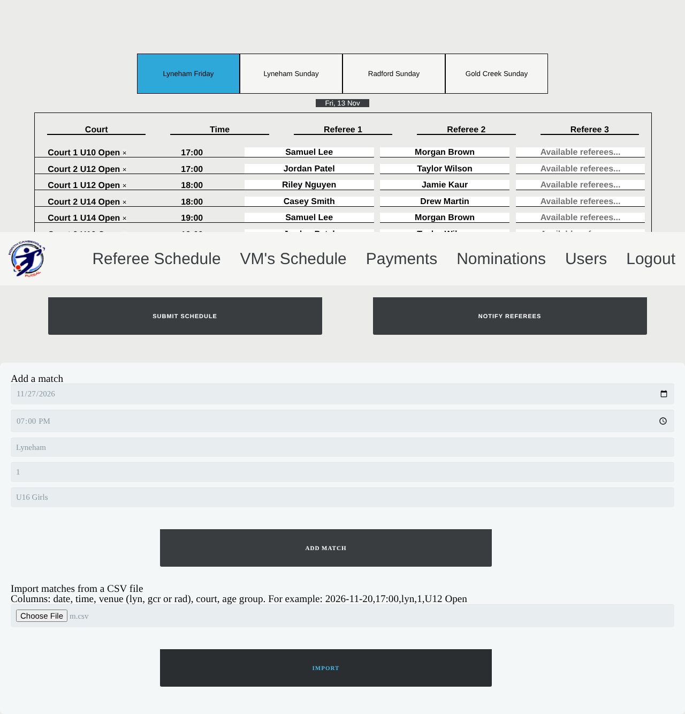
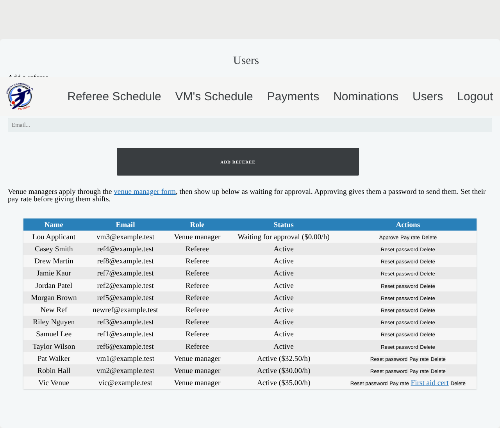
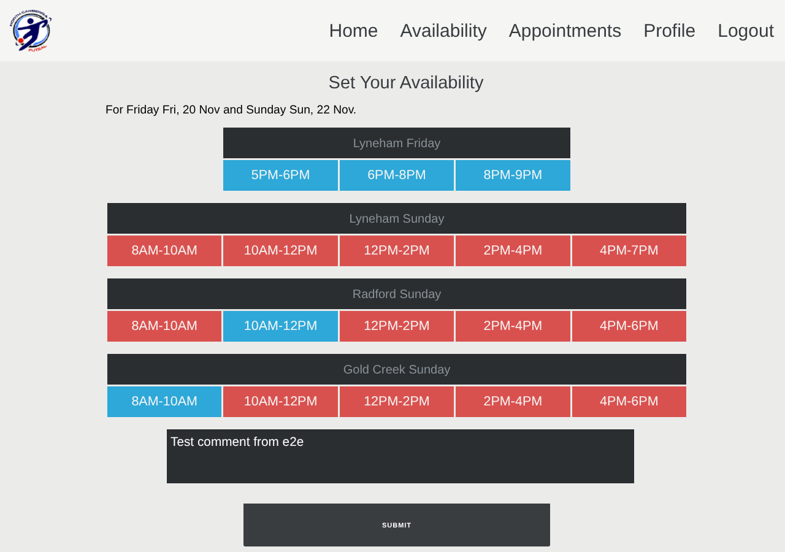
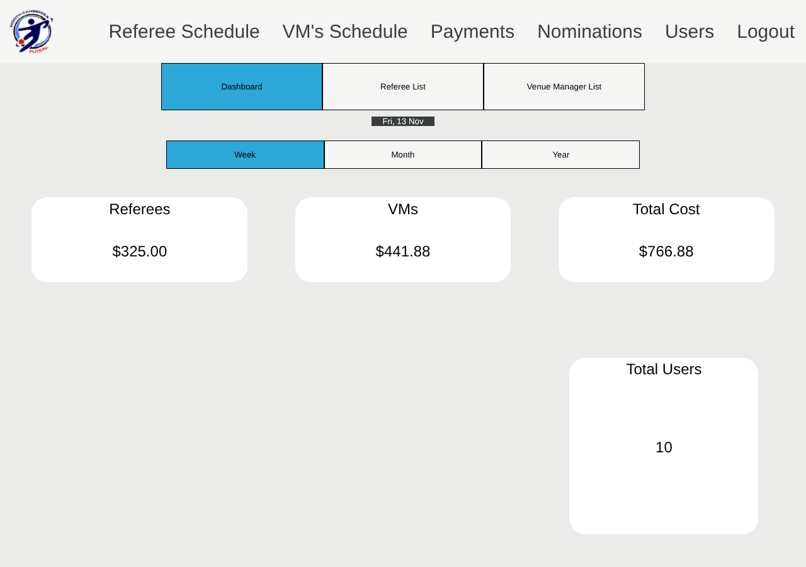

# NCF Referee App

A web app that runs referee and venue-staff scheduling for a community futsal
club: people submit their weekend availability, the admin appoints referees
to matches and venue managers to shifts, everyone gets emailed, and
payments are worked out from what was worked.

Built for and used by North Canberra Futsal (2020-2023), then rebuilt in 2026
into a secure, tested system.

**[Try the demo](https://bnbaldwin.com/referee-app/demo/)** (the real front end with a simulated server and fake data, running in your browser) or read the **[case study](https://bnbaldwin.com/referee-app/)**.



## The problem

Each weekend the club runs dozens of junior matches across three venues. Every
match needs two or three referees, and every venue needs a manager on shift.
Before this app, availability came in by text and email and the schedule
lived in a spreadsheet. Pay was then counted by hand.

## What it does

- **Referees and venue managers** tick the slots they can do. They see their
  appointments or shifts, confirm shifts, and edit their profile and bank details.
- **The admin** sees, for each match, only the referees who are available for
  that time and venue. They appoint with a type-ahead box, then email everyone
  in one click.
- **Fixtures** can be added one at a time or imported from a CSV file.
- **Payments**: match pay is worked out by the database from the age group, and
  shift hours from the start and end times. Totals by week, month or year
  export to CSV.
- **Public forms** for team nominations and venue manager applications, with
  admin approval.

## Stack

PHP 8 (no framework), MySQL/MariaDB, jQuery, PHPMailer. It is deliberately
plain so it runs on the cheapest shared hosting, the kind a volunteer-run club
can afford.

## Engineering highlights

- **The 2026 security rebuild.** The original app trusted a browser cookie to
  say who you were, stored passwords in plain text, and had SQL injection in
  several endpoints. Now the server owns identity through sessions. Every
  endpoint has a role check, passwords are hashed with bcrypt, and every
  query is a prepared statement. Details are under "How security works" below.
- **Zero-downtime password migration.** A legacy plain-text password still
  works one last time. On that login it is replaced by a hash, so users never
  have to be reset.
- **Schema recovery.** No schema survived, so it was rebuilt from the queries in
  the code plus the structure of old exports. That included the generated
  columns for pay and hours.
- **Tests**: a curl-based security suite (logged-out, wrong-role, CSRF,
  injection and blocked-file checks) and a Playwright browser suite covering
  every role's main flow. Both run against MariaDB and against Apache with the
  production `.htaccess` rules.
- **Demo mode** (`DEMO=1`) shows one-click logins for each role and blocks
  actions that would let visitors lock each other out.

| | |
|---|---|
|  |  |
|  |  |

All data in screenshots and seed files is fake.

## Who can do what

| Role | Can |
|---|---|
| Referee | Submit availability, see their appointments, edit profile, change password |
| Venue manager | Submit availability, see and confirm shifts, edit profile, change password |
| Admin | Everything below, plus the dashboard |
| Public (no login) | Team nomination form (`nominationForm.html`), venue manager application (`venueManagerForm.html`) |

Admin pages: Referee Schedule (add or import matches, appoint referees, email
them), VM's Schedule (shifts, availability, email), Payments, Nominations,
Users (add referees, approve venue managers, reset passwords, pay rates).

## How security works (short version)

- **Passwords** are stored as `password_hash()` hashes (bcrypt), never in
  plain text. A plain-text password from an old import still works once and
  is replaced by a hash on that login.
- **Sessions**: logging in creates a PHP session (an `HttpOnly` cookie the
  browser's JavaScript cannot read). Every endpoint checks the session and the
  user's role on the server. The browser never decides who someone is.
- **SQL injection**: every query uses prepared statements (values are sent
  separately from the SQL, so input can never change the query).
- **CSRF** (another site making your browser post to this one): every POST
  must carry the `X-Requested-With` header, which other sites cannot add.
- **No CORS**: only pages on this site can call the API.
- **Uploads** get random names, are type-checked by content, and are only
  served through `refereeapp/file.php` after a login check.
- **Errors** are logged on the server; the browser only sees a generic message.

## Run it locally

Needs PHP 8.1+ (with `pdo_mysql`, `mbstring`, `fileinfo`) and MySQL 8 or MariaDB 10.6+.

```bash
mysql -u root -e "CREATE DATABASE ncf CHARACTER SET utf8mb4"
mysql -u root ncf < db/schema.sql
cp refereeapp/config.example.php refereeapp/config.php   # then edit DB_USER / DB_PASS
php db/seed.php                                          # fake people and fixtures
php -S 127.0.0.1:8000 router.php
```

Open http://127.0.0.1:8000 and log in as `admin@example.test`,
`ref1@example.test` or `vm1@example.test`, password `password123`.
Emails are written to `storage/mail.log` instead of being sent
(`MAIL_MODE=log`).

## Tests

With the server running on a freshly seeded database:

```bash
bash tests/api-smoke.sh            # security checks with curl (14 checks)
node tests/e2e.js                  # every main flow in a real browser (31 checks)
```

`tests/e2e.js` needs Playwright: `npm install playwright && npx playwright install chromium`.
It changes data, so run `php db/seed.php --yes` before each run.

## Deploy to a cPanel-style host

1. **Database**: in cPanel > MySQL Databases, create a database and a user,
   and give the user SELECT, INSERT, UPDATE, DELETE on it. In phpMyAdmin,
   select the database and import `db/schema.sql`.
2. **Files**: upload everything in this repo to `public_html` (or a
   subfolder) except `db/`, `tests/` and `.git/`. Keep the `.htaccess` files:
   they block config, uploads and library code from the web.
3. **Config**: copy `refereeapp/config.example.php` to `refereeapp/config.php`
   on the server and fill in the database details, `APP_URL`, `ADMIN_EMAIL`
   and email settings. Set `MAIL_MODE` to `smtp` once SMTP details are in.
   For Gmail, use an App Password from a Google account with 2-step
   verification, never the account password.
4. **Uploads**: ideally set `UPLOAD_DIR` to a folder outside `public_html`
   (e.g. `/home/<you>/ncf-uploads`). If you leave it, `uploads/.htaccess`
   still blocks direct access.
5. **First admin**: in cPanel > Terminal (or over SSH) run
   `php db/create-admin.php you@example.com "First" "Last"` from the folder
   that holds the files (upload `db/create-admin.php` for this step, then
   delete it). It asks for the password.
6. **HTTPS**: turn on AutoSSL in cPanel, then uncomment the HTTPS redirect in
   `.htaccess`.
7. Log in as the admin, add referees on the Users page, add matches on
   Referee Schedule.

Never run `db/seed.php` on the live database: it deletes everything.

## Layout

- `*.html`, `css/`, `js/index.js`, `img/` - front end (jQuery). Pages call the API with AJAX.
- `refereeapp/*.php` - one endpoint per action. All start with `require __DIR__ . '/lib/bootstrap.php'`.
- `refereeapp/lib/` - shared config, database, session, auth, upload and mail code.
- `phpMailer/` - vendored PHPMailer.
- `db/` - schema, fake seed data, admin creation script.
- `uploads/`, `storage/` - runtime files, git-ignored.
- `router.php` - only for `php -S`; mimics the `.htaccess` blocking.

## Run a public demo

`bash tools/build-demo-package.sh` makes `dist/ncf-referee-demo.zip` (site
files plus a `config.php` with `DEMO` on and email off) and
`dist/ncf-schema.sql`. Import the SQL in phpMyAdmin, upload and unzip the files,
and fill in the four database values in `refereeapp/config.php`.

In demo mode the first request each day wipes the tables and reloads fake
data (`refereeapp/lib/seed.php`). It doesn't need cron, so it works on free hosts.

## History

The first three commits are dated snapshots imported from local backups
(2020, July 2022, March 2023), with credentials replaced by placeholders.
The schema's types and generated columns come from the structure (no rows)
of 2021 database exports found in older repos.
